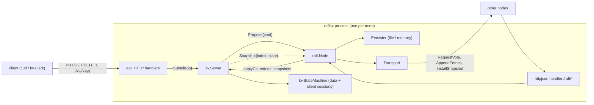

# raft-kv-go

[](https://github.com/rahulkumar96t/raft-kv-go/actions/workflows/ci.yml)

An educational but careful implementation of the Raft consensus algorithm in Go, with a linearizable
key-value store on top. Raft is written against a small `Transport` interface, so the same code runs
over an in-memory network that injects partitions, drops, delays and reordering (for tests) and over
HTTP/JSON (for a real three-node cluster on your laptop). The test suite checks the Raft safety
properties continuously while it breaks things, and verifies client histories with a
linearizability checker. Standard library only.

## Features

- **Leader election** with randomised timeouts, the election restriction (§5.4.1) and persisted
  term/vote, so a restarted node never votes twice in a term.
- **Log replication** with the AppendEntries consistency check, conflict truncation that ignores
  stale/reordered requests, and *fast backtracking* (conflict term/index hints skip a whole term per
  round trip).
- **Commit rule** from §5.4.2: a leader only commits entries from its own term by counting replicas,
  and appends a no-op on election so earlier entries commit promptly.
- **Persistence** through a `Persister` interface: in-memory for tests, file-backed for real nodes
  (write temp file, fsync, rename, fsync directory; CRC-checked).
- **Log compaction**: the service snapshots when the persisted log exceeds a threshold; lagging
  followers are caught up with `InstallSnapshot`.
- **Linearizable KV store**: `Put`, `Get` and `Delete` all go through the log. Each request carries a
  `(ClientID, Seq)` pair; the state machine remembers the last result per client (also inside
  snapshots), so retries are applied at most once.
- **Pluggable transports**: `transport/simnet` (seeded fault injection, JSON-serialised messages,
  late delivery after the sender gave up) and `transport/httpjson`.
- **HTTP client API** with `307` redirects to the leader and idempotency headers.

## Architecture



| Package | What it does |
|---|---|
| `raft` | Election (`election.go`), replication and commit (`replication.go`), snapshots (`snapshot.go`), node lifecycle, timers and the applier (`node.go`), persisters (`persist.go`). |
| `kv` | `StateMachine` (data + de-duplication sessions), `Server` (glues a node to the state machine, waits for proposals to apply), `Clerk` (retrying client). |
| `transport/simnet` | In-memory network: disconnect, partition, drop, delay, reorder; seeded. |
| `transport/httpjson` | Raft RPCs as JSON over HTTP POST. |
| `api` | Client-facing HTTP API. |
| `internal/lincheck` | Linearizability checker used by the KV tests. |
| `cmd/raftkv` | The node binary. |

Inside `raft.Node`, one mutex guards all state. Slow work runs outside it in dedicated goroutines: a
ticker for election/heartbeat timers, one replicator per follower (at most one AppendEntries or
InstallSnapshot in flight per follower; proposals that arrive meanwhile are batched into the next
one) and a single applier, which is the only sender on the apply channel and therefore keeps
snapshots and entries in log order.

## Quickstart

Requires Go 1.23 or newer.

```sh
make test       # go test -race ./...
make cluster    # builds bin/raftkv and starts nodes on 127.0.0.1:7001-7003 (logs and state in ./data)
make cluster-status
make cluster-stop
```

Run a node by hand:

```sh
go run ./cmd/raftkv --id 1 \
  --cluster 1=127.0.0.1:7001,2=127.0.0.1:7002,3=127.0.0.1:7003 \
  --data data/node-1 --snapshot-bytes 1048576
```

Each node listens on its own `--cluster` entry and serves both the peer RPCs (`/raft/*`) and the
client API there.

## Usage

```sh
# Writes to a follower are redirected to the leader (307 keeps method and body; -L follows it).
$ curl -i -X PUT --data world http://127.0.0.1:7001/kv/hello
HTTP/1.1 307 Temporary Redirect
Location: http://127.0.0.1:7002/kv/hello
X-Raft-Leader: 2

$ curl -L -X PUT --data world http://127.0.0.1:7001/kv/hello       # 204
$ curl -L http://127.0.0.1:7003/kv/hello                           # world
$ curl -L -X DELETE http://127.0.0.1:7003/kv/hello                 # 204 (404 if absent)

# Idempotent writes: retrying with the same client ID and sequence number is applied once.
$ curl -L -X PUT -H 'X-Client-Id: app-1' -H 'X-Request-Seq: 42' --data v http://127.0.0.1:7001/kv/k

$ curl http://127.0.0.1:7001/status
{"id":1,"term":2,"role":"leader","leader":1,"commit_index":8,"last_applied":8,"first_index":0,"last_index":8}

# Failure drill
$ scripts/cluster.sh kill 2      # kill a node (e.g. the leader)
$ scripts/cluster.sh status      # a new leader appears after an election timeout
$ scripts/cluster.sh restart 2   # it rejoins with its persisted term, vote and log
```

A request that times out returns `503` with "outcome unknown"; retrying it with the same
`X-Client-Id`/`X-Request-Seq` is safe.

**What was verified by hand** (macOS, Apple M4 Pro, Go 1.27.3): started the three-node cluster with
`scripts/cluster.sh start`; a PUT to a follower returned `307` to the leader and `curl -L` stored the
value; GET from another follower returned it; killing the leader (node 2) produced a new leader
(node 1, term 2) within the election timeout and the data was still readable and writable; the
restarted node came back as a follower in term 2 and caught up. With
`RAFTKV_ARGS="--snapshot-bytes 4096"`, a node that was down during 300 writes came back and was
caught up by `InstallSnapshot` (its status showed `first_index` 282, and it served the latest value).

## Design decisions and trade-offs

- **Reads go through the log.** It is the simplest way to make `Get` linearizable: a deposed leader
  that still believes it leads cannot answer because it cannot commit. The cost is a log write per
  read. ReadIndex or leader leases would avoid that (see roadmap).
- **One in-flight replication RPC per follower.** It keeps `nextIndex`/`matchIndex` updates
  trivially ordered and bounds memory, at the cost of pipelining. Batching recovers most of the
  throughput for this use.
- **No-op on election.** Lets a new leader commit entries from earlier terms right away instead of
  waiting for the next client write (required by the §5.4.2 commit rule).
- **Fail-stop persistence.** If the persister returns an error the node panics instead of carrying on
  with state it could not make durable.
- **State and snapshot in one file.** `FilePersister` rewrites one file atomically (temp + fsync +
  rename), which keeps the pair consistent after a crash, but rewrites the whole snapshot on every
  log append. Fine for small state; a real system would keep a segmented log next to snapshot files.
- **Whole-snapshot InstallSnapshot.** Snapshots are sent in one RPC (no chunking/offsets).
- **Simulated network serialises messages.** simnet JSON-encodes every request and reply, so nodes
  never share memory (the race detector would catch it if they did), and an RPC type that does not
  survive the wire fails in tests too. Delivery happens on its own goroutine, so requests can arrive
  after the sender has timed out, like on a real network.
- **Determinism is partial.** All of simnet's fault decisions come from one seeded generator and the
  tests derive seeds from their names (override with `RAFT_SEED`), but goroutine scheduling still
  decides which RPC draws which decision, so runs are reproducible in spirit, not bit for bit.

## Testing

```sh
go vet ./... && go test -race ./...
```

| Area | Tests |
|---|---|
| RPC rules (white-box) | stale terms, one vote per term, election restriction, vote/term survive restart, missing-prev and conflict-term hints, conflict truncation, delayed short AppendEntries does not truncate, commit index bounded by the verified prefix, leader backtracking, the Figure 8 commit rule, snapshot compaction and InstallSnapshot (matching and conflicting logs), config validation, single-node cluster. |
| Cluster behaviour (simnet) | initial election and stable term; re-election after leader loss and no leader without a quorum; 7-node election churn on a mildly lossy network; basic agreement; follower failure and "leader alone cannot commit"; partition and heal with 40 stranded entries on the minority side that must never be applied; crash/restart persistence; agreement under random crashes, restarts, drops, delays and reordering (with and without snapshots); snapshot catch-up and restart from snapshot. |
| Continuous invariants | Every cluster test asserts **Election Safety** (at most one leader per term, recorded via a hook on every election win) and **State Machine Safety** (no two nodes apply different commands at the same index; every node applies in order without gaps). |
| KV | de-duplication in the state machine and across snapshots; put/get/delete; leader hints; a late retry after another client's write is not re-applied; a client that drops half of its replies still matches a sequential model (including `Delete`'s "existed" result); a minority partition can neither write nor read; snapshots bound the persisted log, catch up a lagging node and survive a full restart. |
| Linearizability | 5 clients run 240 put/get/delete operations on 4 keys against a 5-node cluster while partitions, crashes (including the leader) and restarts are injected; the recorded history is checked per key with a Wing & Gong style search (`internal/lincheck`, which has its own tests with known-good and known-bad histories). |
| Transports and API | simnet partitions, drops, seeded determinism, reordering, late delivery, message copying; a 3-node cluster over real loopback HTTP; HTTP error mapping; the full client API including redirects and idempotency headers. |

60 test functions (plus 4 subtests). Measured on an Apple M4 Pro (12 cores), macOS 27.2, Go 1.27.3:
`time go test -race -count=1 ./...` takes 28-35 s wall clock across runs (packages run in
parallel; `raft` is the longest). To look for timing flakes the suite was also run with
`go test -race -count=5 ./...` (2 min 12 s) and `GOMAXPROCS=2 go test -race -count=3 ./...`, both
without failures. The module declares `go 1.23` and was also vetted and built with Go 1.23.0.

**Mutation check.** To see whether the tests can catch a classic bug, `kv.Server` was temporarily
changed to answer `Get` from local state whenever its node thinks it is the leader (no log round
trip). The targeted test `TestMinorityPartitionCannotServe` failed in 3 of 3 runs (a deposed leader
returned the stale value). The randomised `TestLinearizableUnderFaults` flagged a non-linearizable
history in 2 of 6 subtest runs, so it is a useful net but not a guarantee. The change was reverted.

## Limitations and roadmap

This is a learning project, not a production database. Not implemented:

- cluster membership changes (joint consensus or single-server changes);
- pre-vote and check-quorum, so a node rejoining after a partition with a higher term disrupts the
  current leader (safe, but causes an extra election);
- ReadIndex or lease-based reads (every read is a log write);
- chunked snapshots, pipelined replication, a segmented on-disk log;
- eviction of client sessions (the de-duplication table grows with the number of distinct client IDs);
- TLS or authentication between nodes and for clients.

The tests run a real implementation under a simulated network, which finds many bugs but is not a
proof. A model checker (e.g. TLA+ against the Raft spec) or a Jepsen-style harness against real
processes would be the next step for more confidence.
